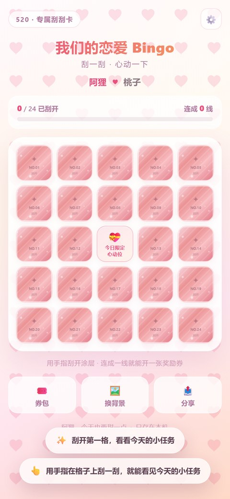
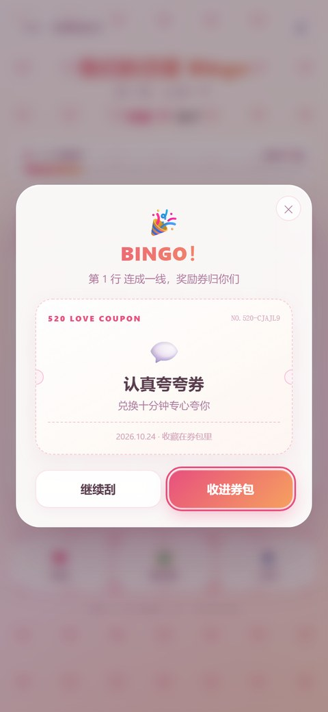
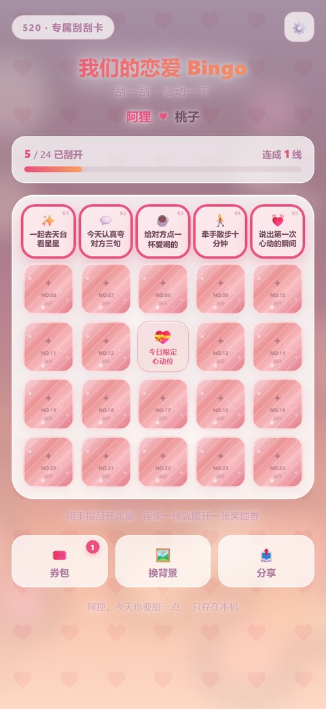
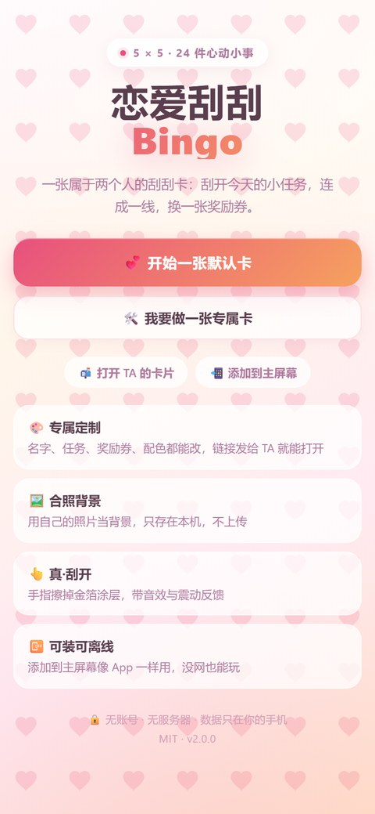
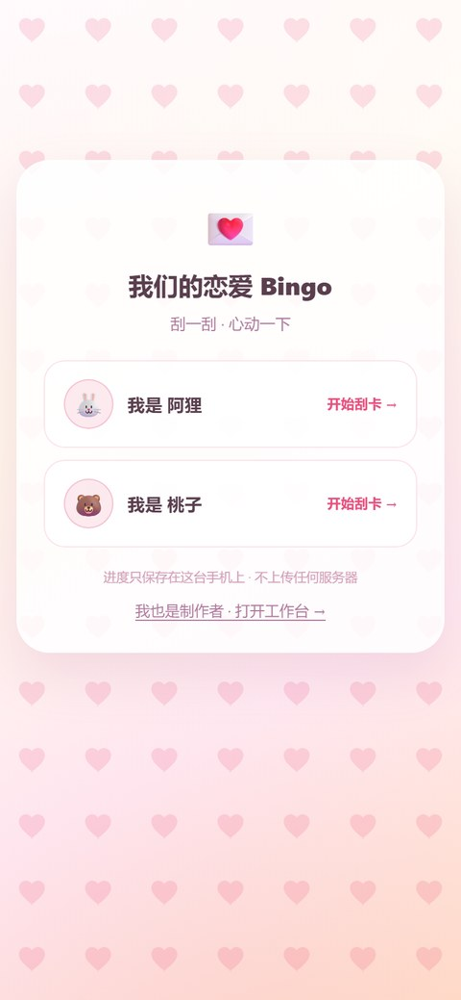
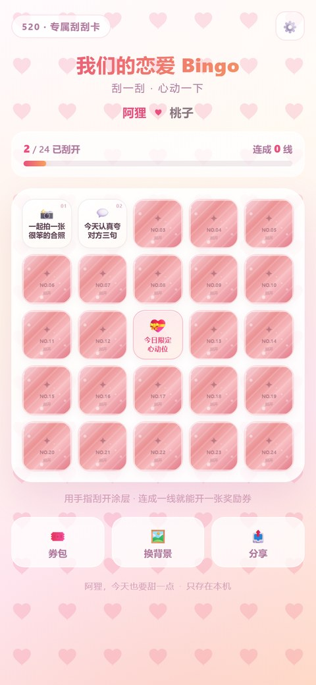
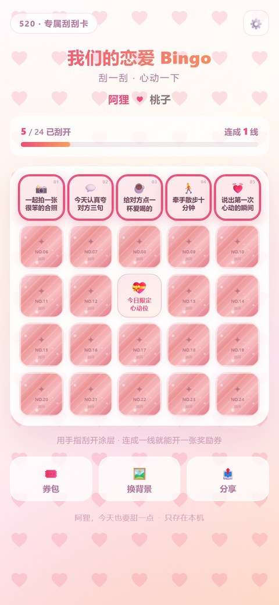
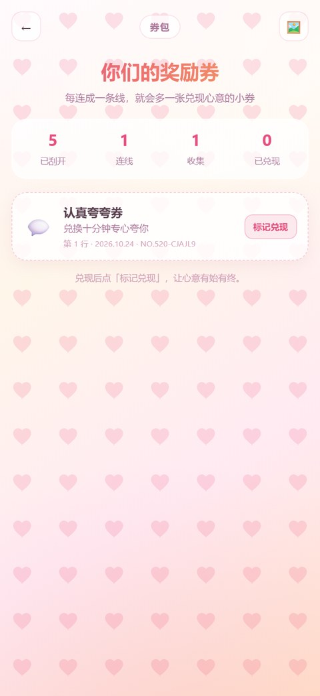
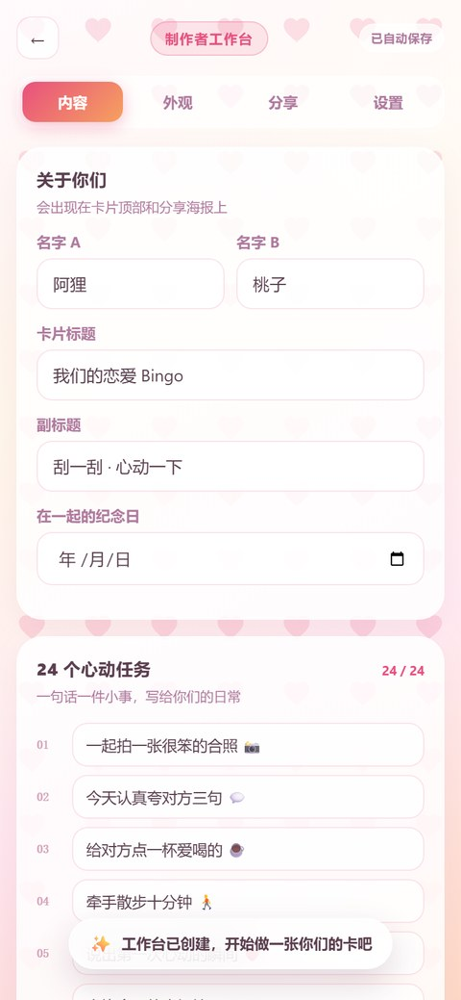
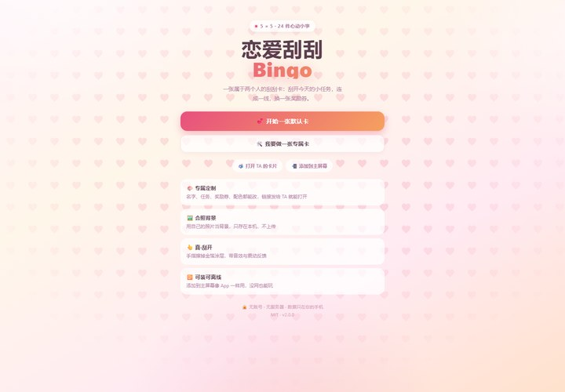

# 💕 Love Scratch Bingo

> **24 little things for two, hidden under scratch foil. Scratch, connect a line, win a coupon.**
> Vanilla JS · Zero dependencies · No server · Installable & offline

**Live demo → https://kriye-hu.github.io/love-bingo/**

[](LICENSE)
[](#stack)
[](#install-on-your-phone)
[](README.md)

  

---

## What it is

A 5×5 scratch card for couples. 24 cells hold small real-life actions; the center is a free "heart" cell.

Scratch the foil off with your finger — a real canvas erase, not a tap-to-flip. Complete a row, column or diagonal
and you win a coupon (hug coupon, "you pick the next date" coupon, …). Collect them in a wallet and mark them redeemed.

The **creator** can rewrite everything: names, all 24 tasks, coupons, colors — and use **your own photo as the background**.
Then share a single link. The other person opens it and the whole card is there. **No sign-up, no server, no tracking.**

---

## Features

| | |
|---|---|
| 👆 **Real scratching** | Canvas coating, finger erase, auto-reveal at 40%; synthesized scratch sound + haptics |
| 🛠️ **Two roles** | Creator signs in with a local passcode; players pick "who am I" and keep their own progress |
| 🔗 **Shareable card link** | Names, tasks, coupons and theme are compressed into the URL (~1.4 KB) |
| 🔐 **Optional access code** | A 4-digit code if you don't want the link forwarded |
| 🖼️ **Your photo as background** | Adjustable blur & wash. The photo never leaves the device and is never in the link |
| 🎨 **5 themes** | Peach, Sakura, Sunset, Mint, Midnight — accent colors and patterns adjustable |
| 🎟️ **12 lines = 12 coupons** | Multiple simultaneous lines queue up; wallet supports "redeemed" state |
| 🖼️ **Poster export** | Generates a 1080×1620 share image with highlighted lines |
| 📴 **Installable & offline** | PWA: add to home screen, full screen, works without network |
| 🔒 **Private by design** | No accounts, no backend, no analytics, no third-party requests |
| ♿ **Accessible basics** | Keyboard reveal, aria labels, reduced-motion support |

---

## Screens

<table>
<tr>
  <td align="center"><br><sub>Home</sub></td>
  <td align="center"><br><sub>Pick who you are</sub></td>
  <td align="center"><br><sub>Scratch it</sub></td>
</tr>
<tr>
  <td align="center"><br><sub>A completed line</sub></td>
  <td align="center"><br><sub>Coupon wallet</sub></td>
  <td align="center"><br><sub>Creator studio</sub></td>
</tr>
</table>

<details>
<summary>Desktop</summary>

</details>

---

## Quick start

```bash
git clone https://github.com/Kriye-hu/love-bingo.git
cd love-bingo
python -m http.server 8080    # or: npx serve .
# open http://localhost:8080
```

There is **no build step**. No npm install. The whole app is static files.
Opening `index.html` directly works too — only PWA install/offline needs http(s).

### Install on your phone

- **iPhone**: Safari → Share → Add to Home Screen
- **Android**: Chrome → menu → Install app

---

## Make your own card (3 minutes)

1. Home → **"Make my own card"** → set a local studio passcode.
2. **Content**: names, title, anniversary, 24 tasks (or 🎲 shuffle from a 60-task library), coupons.
3. **Look**: pick a theme, tweak accent colors, upload a photo as background.
4. **Share**: copy the card link and send it. Optionally turn on a 4-digit access code.
5. They open the link → enter the code → pick their name → start scratching.

Progress, photos and coupons stay on each device. The link only carries content and theme.

---

## Stack

- Plain HTML/CSS/JS — no framework, no bundler, no dependencies
- Canvas 2D for the scratch coating, poster and confetti
- Web Audio for synthesized sounds (no audio assets)
- `CompressionStream` + base64url for the share link, with graceful fallback
- localStorage for the save file; photos compressed to ~1200px JPEG
- Service Worker + Web App Manifest for offline/install
- GitHub Actions for deployment

---

## Privacy

No network requests at all. Everything is in your browser's localStorage.
Export a JSON backup from **Share → Export JSON** if you care about the card.

---

## License

[MIT](LICENSE) © 2026 [Kriye-hu](https://github.com/Kriye-hu)

If this made your day a little sweeter, a ⭐ helps other couples find it.
