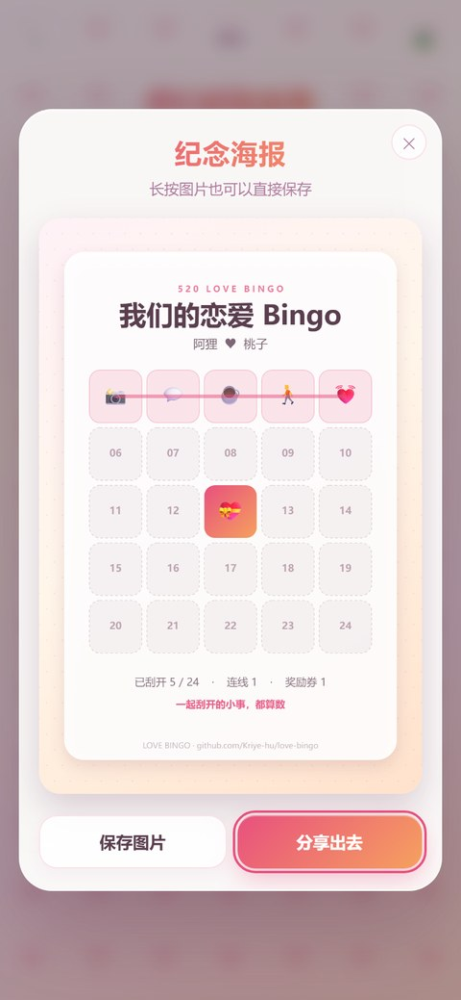
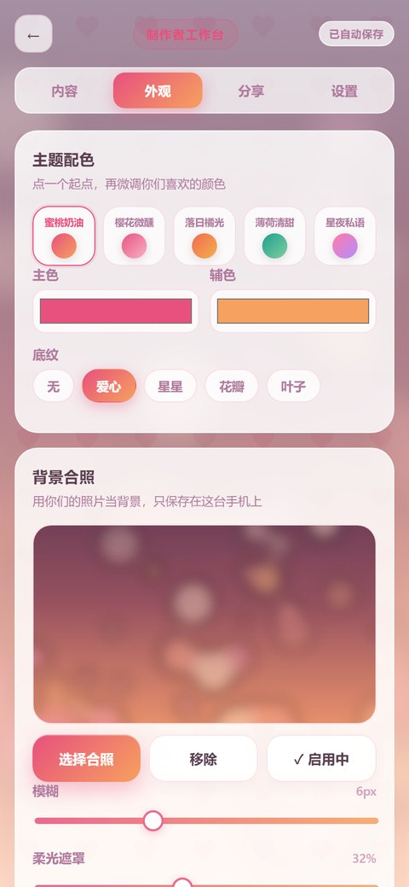
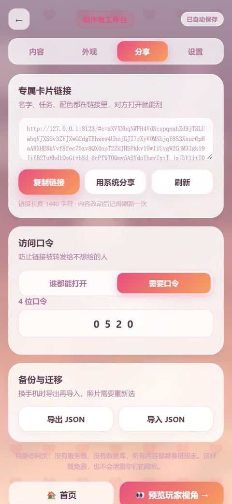
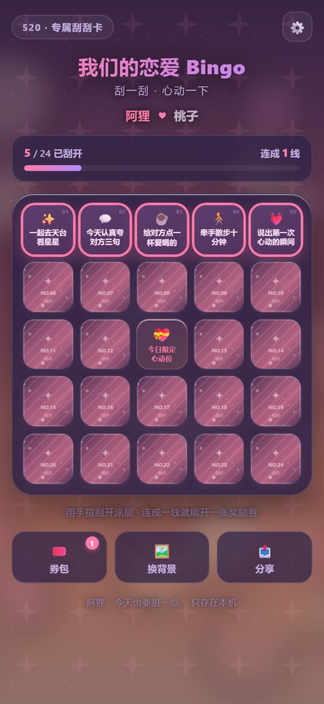
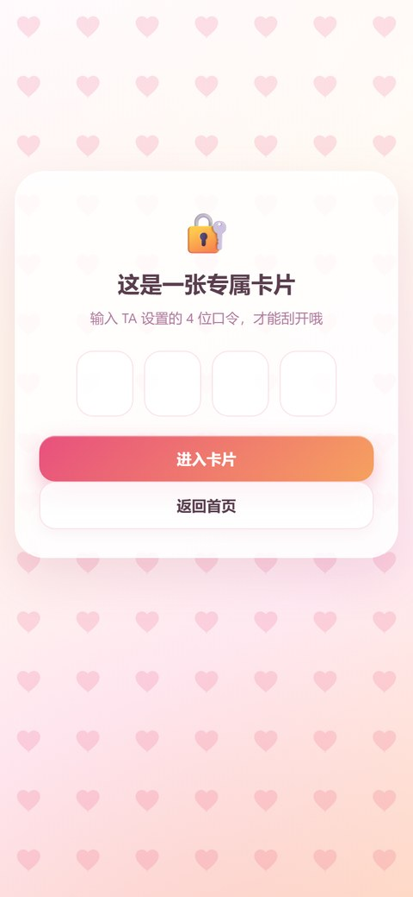
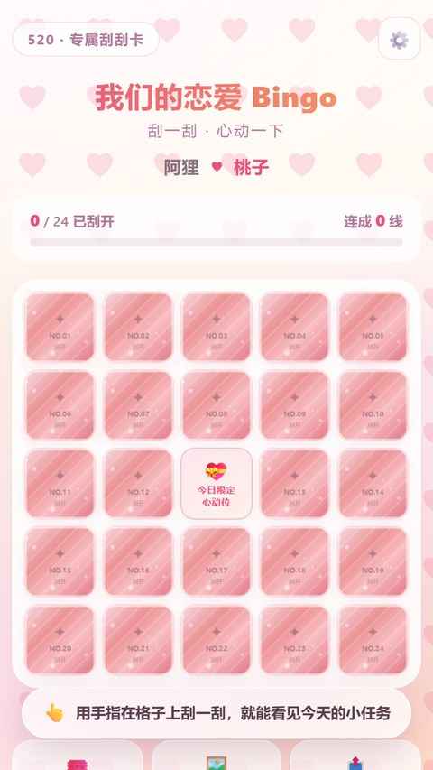

# 💕 恋爱刮刮 Bingo

> **24 件心动小事，刮开、连线、换一张只属于你们的奖励券。**
> 纯前端 · 零依赖 · 无服务器 · 可离线安装到手机桌面

**在线体验 → https://kriye-hu.github.io/love-bingo/**

[](LICENSE)
[](#技术栈)
[](#-可安装可离线)
[](#技术栈)
[](https://github.com/Kriye-hu/love-bingo/stargazers)

[](README.en.md)

  

---

## 这是什么

一张 5×5 的刮刮卡：24 个格子藏着你们今天可以做的小事，正中间是免费的心动位。

用手指**真的把金箔刮掉**（Canvas 擦除，不是点一下翻开），每连成一条线，抽一张奖励券收进券包：
今晚抱抱券、无条件撒娇券、下次约会选择权……

制作者可以改掉全部内容——名字、任务、奖励券、配色，甚至**用你们的合照当背景**，
然后把「专属链接」发给对方。对方打开就是一张为你们做的卡，**不需要注册、不需要服务器**。

---

## ✨ 功能

| | |
|---|---|
| 👆 **真·刮开** | Canvas 涂层 + 手指擦除，刮掉 40% 自动揭开；Web Audio 沙沙声 + 震动反馈 |
| 🛠️ **两种身份** | **制作者**用密码进工作台改内容；**使用者**选「我是谁」后开刮，进度各自独立 |
| 🔗 **专属链接** | 名字、任务、券、配色全部编码进链接（deflate + base64url，约 1.4 KB），发出去就能打开 |
| 🔐 **访问口令** | 不想被转发？开一个 4 位口令，只有知道的人能进 |
| 🖼️ **合照背景** | 上传你们的照片当背景，可调模糊与柔光；照片只留在本机，不会上传也不进链接 |
| 🎨 **5 套主题** | 蜜桃奶油 / 樱花微醺 / 落日橘光 / 薄荷清甜 / 星夜私语，主色辅色和底纹都能微调 |
| 🎟️ **12 条线 = 12 张券** | 横、竖、两条对角线，多线同时达成会依次开券；券包可标记「已兑现」 |
| 🖼️ **纪念海报** | 一键把当前进度画成 1080×1620 的分享图，带连线高亮 |
| 📴 **可安装、可离线** | PWA：添加到主屏幕全屏打开，断网也能玩；新版本自动更新提示 |
| 🔒 **数据不出手机** | 无账号、无后端、无统计、无第三方请求；localStorage 存进度，可导出 JSON 备份 |
| ♿ **基础无障碍** | 键盘 Enter 刮格、aria 标签、`prefers-reduced-motion` 降级 |

---

## 📸 界面

<table>
<tr>
  <td align="center"><br><sub>首页</sub></td>
  <td align="center"><br><sub>打开 TA 的卡片，选「我是谁」</sub></td>
  <td align="center"><br><sub>手指刮开涂层</sub></td>
</tr>
<tr>
  <td align="center"><br><sub>连成一线，格子亮起来</sub></td>
  <td align="center"><br><sub>券包：标记兑现</sub></td>
  <td align="center"><br><sub>纪念海报</sub></td>
</tr>
<tr>
  <td align="center"><br><sub>制作者工作台</sub></td>
  <td align="center"><br><sub>上传合照、调模糊</sub></td>
  <td align="center"><br><sub>专属链接 + 访问口令</sub></td>
</tr>
<tr>
  <td align="center"><br><sub>星夜主题</sub></td>
  <td align="center"><br><sub>口令卡</sub></td>
  <td align="center"><br><sub>小屏 360px 也不挤</sub></td>
</tr>
</table>

<details>
<summary>桌面端长这样</summary>

</details>

---

## 🚀 快速开始

### 1. 直接玩

打开 <https://kriye-hu.github.io/love-bingo/> → 「开始一张默认卡」。

### 2. 本地跑

不用安装依赖、不用构建，随便起个静态服务：

```bash
git clone https://github.com/Kriye-hu/love-bingo.git
cd love-bingo
python -m http.server 8080
# 或者：npx serve .
```

打开 <http://localhost:8080>。
（直接双击 `index.html` 也能玩，只是 PWA 离线与安装需要 http/https。）

### 3. 装到手机桌面

- **iPhone**：Safari 打开 → 分享 → 添加到主屏幕
- **Android**：Chrome 打开 → 菜单 → 安装应用 / 添加到主屏幕

装好后是全屏的，没网也能刮。

---

## 🛠 三分钟做一张你们的卡

1. 首页点 **「我要做一张专属卡」**，设置一个工作台密码（只存在本机，用于防止误入）。
2. **内容**页：改名字、标题、纪念日，一条条写 24 个任务（也可以点 🎲 从 60 条灵感库里随机换一批）。
3. 写奖励券：每连成一条线就从这里抽一张，张数随意。
4. **外观**页：选主题、调主色，上传一张合照当背景（可调模糊与柔光）。
5. **分享**页：复制「专属链接」发给 TA。担心被转发，就打开「需要口令」。
6. TA 在手机上打开链接 → 输口令（如果开了）→ 选「我是谁」→ 开始刮。

> 进度、照片、券包都只存在各自的手机上；链接里只有任务和配色。
> 所以**两个人各刮各的**，想同步就让对方也打开同一条链接。

---

## 🧠 几个设计决定

**为什么没有后端？**
这是个「打开就玩、玩完就走」的小东西。加账号体系意味着服务器、数据库、隐私政策和运维，
而它最大的卖点恰恰是——**不用注册、不会收集你任何东西**。纯静态还能免费托管在 GitHub Pages 上，
永远不会有「服务到期，你们的卡打不开了」。

**内容怎么跟着链接走？**
把卡面压成短字段 JSON，用 `CompressionStream('deflate-raw')` 压一遍，再 base64url 进 `#c=`。
不支持压缩的旧浏览器自动降级成不压缩的 base64。链接约 1.4 KB，不会把照片塞进去——
照片是本机的，想用同一张让对方自己选一次。

**涂层为什么不用 CSS？**
因为要你真的「刮」。每格一张小 canvas，画玫瑰金渐变 + 斜向拉丝 + 星星，
`destination-out` 擦除，另用 32×32 采样图算擦除比例，超过 42% 就把整格揭开。
支持鼠标拖动，也支持「轻点即开」模式。

**为什么 24 格 + 中心免费？**
5×5 里一共 12 条可能的线，每条线一张券，正好是一个「可完成、又不会一次玩完」的节奏。

---

## 📁 项目结构

```
.
├── index.html                  # 唯一入口（无构建、无打包）
├── manifest.webmanifest        # PWA
├── sw.js                       # 离线缓存
├── assets/
│   ├── css/app.css             # 主题变量 + 全部样式
│   ├── js/
│   │   ├── data.js             # 60 条任务灵感库、15 张券、5 套主题
│   │   ├── store.js            # localStorage 存档 / 口令哈希 / v1 迁移
│   │   ├── codec.js            # 专属链接编解码
│   │   ├── ui.js               # 弹窗 / 面板 / Toast / 彩带 / 音效
│   │   ├── theme.js            # 主题、底色、照片压缩
│   │   ├── scratch.js          # Canvas 刮开涂层
│   │   ├── game.js             # 5×5 连线、开券、统计
│   │   ├── player.js           # 使用者界面
│   │   ├── studio.js           # 制作者工作台
│   │   ├── poster.js           # 分享海报
│   │   └── app.js              # 路由 / 首页 / 导入链接 / PWA
│   └── icons/                  # 图标（脚本生成）
├── docs/                       # README 截图
├── legacy/                     # v0/v1 单文件版本，留作纪念
├── tools/
│   ├── make_assets.py          # 生成图标与 OG 图
│   ├── shot.mjs                # 用 CDP 跑真实交互并截图
│   └── build_docs.py           # 截图压成 README 尺寸
└── .github/workflows/pages.yml # 推送 main 自动部署
```

---

## 🧩 技术栈

- **原生 HTML / CSS / JavaScript**，没有框架、没有 npm 依赖、没有构建步骤
- **Canvas 2D**：刮卡涂层、纪念海报、彩带粒子
- **Web Audio**：合成音效（无音频素材）
- **CompressionStream / base64url**：把卡片内容塞进 URL
- **localStorage + IndexedDB 无关**：照片压到 1200px JPEG 后存 localStorage，超限自动降级
- **Service Worker + Web App Manifest**：离线与安装
- **GitHub Actions**：push 即部署

浏览器：Chrome / Edge / Safari 16.4+ / Firefox 113+（更老的浏览器会自动降级为未压缩链接与无动画）。

---

## 🗺️ Roadmap

- [x] v2.0：双角色、专属链接、合照背景、券包、海报、PWA
- [ ] 双人实时同步（可选自带 Supabase / WebRTC，仍保持「不注册也能玩」）
- [ ] 任务库按场景分组（异地恋 / 同居 / 纪念日）
- [ ] 更多底纹与字体，自定义卡片标题字体
- [ ] 多语言（EN / JA / KO）
- [ ] 把海报做成可切换的 3 种版式

有想要的功能，欢迎开 [Issue](https://github.com/Kriye-hu/love-bingo/issues) 或直接 PR。

---

## ❓ 常见问题

**Q：数据会丢吗？**
存在浏览器 localStorage 里。清理浏览器数据、换手机、用无痕模式都会丢。
重要的卡请在**分享 → 导出 JSON** 备份（照片需要重新选）。

**Q：两个人能同步进度吗？**
目前不能，各自记录各自的。这是有意的：不需要账号，也就没有「谁改了哪一格」的冲突。
想要同步可以看 Roadmap 里的方案。

**Q：照片会上传吗？**
不会。照片在浏览器里压成 JPEG 后就存本机，连分享链接里都没有。整个项目没有任何网络请求。

**Q：能白嫖部署吗？**
可以，GitHub Pages 永久免费。仓库自带 Actions 工作流，或者直接 Settings → Pages 选 main 分支。

**Q：可以直接改内容文件吗？**
可以，所有文案都在 `assets/js/data.js`（任务库、奖励券、主题），改完刷新即可。

---

## 🤝 一起把它做得更好

- ⭐ **点个 Star** 是这个项目继续更新的最大动力
- 有好的「心动任务」文案 → 直接改 `assets/js/data.js` 的 `TASK_LIBRARY` 发 PR
- 发现 bug 或想要新主题 → 开 Issue，带上手机型号和截图
- 这个项目没有构建步骤，改完刷新就能看到效果，对新手非常友好

详见 [CONTRIBUTING.md](CONTRIBUTING.md)。

---

## 📄 License

[MIT](LICENSE) © 2026 [Kriye-hu](https://github.com/Kriye-hu)

> 用不用得上不重要，希望你们刮开的每一格都算数。💗
